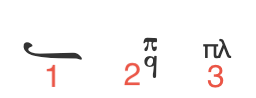

# Advanced Workflows

These workflows are useful when a score needs something beyond the supplied initial martyriæ or the automatic page layout.

## Initial Martyria Styles

An initial martyria is written according to a style. The style decides the language, whether the mode is identified by text or by the traditional sign, how the mode number is written, and which paragraph styles supply its typography. The mode itself, the starting note, and any fthora are still chosen per initial martyria in the initial martyria dialog, as described in [Updating the initial martyria](./writing-music.md#insert-another-initial-martyria).

To manage styles, open `Format -> Initial Martyria Styles...`, or select an initial martyria and press `Manage styles...` in the Properties pane.

The list on the left contains the styles you have created, under `Custom`, followed by the built-in styles grouped by language. The style the document uses is marked `Default`. Selecting a style opens it in the panel on the right, where everything about it can be changed in place. The preview at the top of the panel shows the style in all eight modes.

The buttons under the list are `New style` and `Duplicate` on the left, and `Reset to base` and `Delete` on the right.

Styles are stored in the score. Nothing is written to the score until you press `Use for this document`, which makes the selected style the document default, or, when the dialog was opened from an initial martyria, `Apply`, which sets the selected style on that initial martyria only. `Cancel` discards every change made in the dialog. When a style is deleted, any initial martyria that used it follows the document default.

Built-in styles are read-only. Changing anything while one is selected continues the change in a copy of it, named `<style> copy` and marked `Based on` the original; press `Reset to base` to return the copy to the style it came from. Press `Duplicate` if you would rather make the copy and name it first.

### Creating a Style

Press `New style` to start from the default style of your language, or change an existing style as described above. The wording choices occupy the scrolling area of the panel.

- `Language`: the language the mode name is written in.
- `Mode identification`: `Sign only`, `Text and sign`, or `Text only`.
- The wording list shows every way the selected language can write the mode name with that identification, each row previewed in the modes that tell the rows apart. Click a row to use it. When the number is printed, the rows are grouped by how it is written: digits, Roman numerals, alphabetic numerals, or words. Arabic offers both Western digits (اللحن 1) and Arabic-Indic digits (اللحن ١).

The `Name` field sits above the preview, and `Paragraph style` and `Greek paragraph style` under `Typography`, below the wording list. The regular paragraph style formats non-Greek text. The Greek paragraph style formats Greek mode names, original Greek starting-note names, and the Greek plagal abbreviation. The paragraph style matching the selected language also supplies the size used to match the mode-sign and pitch glyphs, the fixed separator spacing, the ambitus parentheses, and the shared glyph color and outline. Typography can be changed by selecting a different paragraph style or editing one in the Paragraph Styles dialog; Initial Martyria styles do not store their own typography overrides.

Every row prints differently, so the list offers exactly the options the language can express, and choosing one row never changes anything else.

For a language that is not written in Greek, check `Transliterate starting note` to write the starting note as `Pa` instead of `Πα`. For a language whose digit ordinals have a suffix, such as the `st` of `1st`, check `Use ordinal forms` under `Typography` to use the font's ordinal glyphs where the font provides them. A row written exactly like a built-in style shows that style's name under its preview.

### The Initial Martyria Paragraph Style

The `Paragraph Styles` dialog, opened from `Format -> Paragraph Styles...`, includes the built-in `Initial Martyria` and `Initial Martyria (Greek)` styles. Changing `Initial Martyria` restyles regular text and also flows through to Greek text for properties that the Greek child does not override. Changing `Initial Martyria (Greek)` affects only Greek text. An Initial Martyria style can select any paragraph style for either role.

When an older document is imported, its Initial Martyria color is migrated to `Initial Martyria`, while its size and outline are migrated to `Initial Martyria (Greek)`. If the document uses the Stathis Series music font, the migrated Greek paragraph style uses GFS Porson instead of GFS Didot.

## Create a custom initial martyria

If an [initial martyria style](#initial-martyria-styles) cannot express the wording you need, use a rich text box. Any rich text box can change the musical mode. This lets you build an initial martyria that is not available in the Initial Martyria dialog or write its surrounding text in another language.

1. Choose `Insert > Rich Text Box`.
2. Enter and format the text of the initial martyria.
3. Select the box and open `View > Properties`.
4. Enable `Change Mode`, then choose the starting note and scale.
5. If the initial martyria contains a fthora, set the `Parallagē Note` as well.

For example, a triphonic hymn in the plagal of the fourth mode may have a Ni fthora on Ga. In that case, Ga is the starting note and Ni is the parallagē note.

You can replace the Greek word `ήχος` with `mode`, `glas`, `глас`, or another suitable term without changing how the element affects the melody.

### Insert the symbols

The rich-text toolbar has controls for inserting neumes, martyriæ, and the Greek plagal symbol.

After inserting a neume or martyria, select it to adjust its color, size, position, and spacing.

### Position an inline initial martyria

Enable `Inline` when the initial martyria should sit within the musical flow. The box then has two content lines:

- The top line aligns with the neumes.
- The bottom line aligns with the lyrics.

Use `Top Y Offset` and `Bottom Y Offset` in Properties for small vertical corrections. Enable `Center on Page` when the box should be centered across the page rather than within the remaining space on its line.

Example files show several configurations: [editable BYZX](https://github.com/neanes/neanes/blob/master/examples/Custom%20Mode%20Key%20Demo.byzx) and [PDF](https://github.com/neanes/neanes/blob/master/examples/Custom%20Mode%20Key%20Demo.pdf).

## Build a prosomoion template

A prosomoion reuses the melodic and syllabic pattern of an automelon. Prepare the automelon with `Save Current Melismas`, lock its lyrics, and save it as a reusable template. The [prosomoion tutorial](/guide/lyrics.html#create-a-prosomoion-from-an-automelon) explains the complete workflow, including `Accepts Lyrics`, replacement text, and Greek syllables.

## Set up a book

Use `File > Page Setup` for facing pages and header/footer variants. Give each source heading a `Running Marker Role` when its text should appear in a running header. The [Page Layout and Books guide](/guide/page-layout.html) covers page-number tokens, chapter openings, variant precedence, and common book layouts.

## Correct a difficult collision

If the same collision occurs throughout the score, begin with Page Setup or the automatic line breaks. For one isolated collision, open the selected neume's Positioning dialog and move the affected sign. See [Fine-tune positions](/guide/writing-music.html#fine-tune-positions) for an illustrated example.

## Design repeated text

Use `Format > Paragraph Styles` when titles, headings, lyrics, or other repeated text should share their formatting. The [Paragraph Styles guide](/guide/text-and-styles.html#apply-a-style) explains how to apply styles, inherit settings, and handle local formatting.
