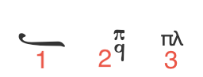

# Initial Martyriæ

An initial martyria establishes the starting note and scale for the music that follows. Choose a supplied initial martyria for the mode and starting pitch you need, then use a style to decide how it is written. Use a rich text box when it needs to sit alongside a heading, within a line of music, or in a fully custom setting.

## Choose an initial martyria

To add one before a hymn or section, select the element that should follow it and choose `Insert > Initial Martyria`. To change an existing one, double-click it, right-click it and choose **Change Initial Martyria**, or use the **Change Initial Martyria** button in its bottom toolbar.

In **Select Initial Martyria**, choose a mode, select the initial martyria with the starting pitch and signs you need, and press **Update**. Double-clicking a choice also applies it. For variants with an optional diatonic fthora, see [Show a diatonic fthora](/guide/faq.html#how-do-i-show-a-diatonic-fthora-in-the-initial-martyria).

The bottom toolbar also lets you choose a style, adjust the size and alignment, or attach a tempo sign. In `View > Properties`, use **Positioning** to set the **BPM**, **Gap Above**, or **Gap Below**. The **Initial Martyria** section contains **Ignore Attractions** and, for third and grave modes, **Permanent Enharmonic Zo**. See [Playback](/guide/playback.html) for how these settings affect the melody.

### Show the ambitus

Select a standalone initial martyria and enable **Show Ambitus** in Properties or in its right-click menu. The ambitus shows the lowest and highest notes from that initial martyria to the next mode change or the end of the score.

## Initial Martyria Styles

A style controls the language, the wording of the mode name, whether a mode sign appears, and the typography. Styles are saved with the score. New scores start with the traditional neume-font form.

### Add or change a style

1. Open `Format > Initial Martyria Styles…`, or select an initial martyria and choose **Manage styles…** in Properties.
2. Choose **Add style**. To revise a style already in the score, use its pencil button (**Change wording**).
3. Choose a **Language**. The picker offers Greek, English, Spanish, Church Slavonic, Russian, Arabic, Romanian, and Indonesian. Some languages offer a choice of terms for the mode, such as **Mode** or **Tone** in English.
4. Click the preview row you want. **Common** shows frequently used wordings. Expand **More wordings** to see additional forms, grouped by how they identify the mode (**Sign only**, **Text and sign**, or **Text only**). Use a **Neume font** choice where available for traditional lettering drawn from the score's music font.
5. In the styles list, give the style a name and choose its paragraph styles. Press **Update** to save the changes.

Where available, enable **Transliterate starting note** to show a form such as `Pa` for `Πα`. The **Plagal sign** switch adds `πλ` beside the mode sign in plagal modes for wordings that offer this choice.

Use **Duplicate** to make a variation of an existing style, for example to keep the same wording at a different size. Editing a style updates every initial martyria that uses it. If you delete a style in use, choose its replacement under **Use instead**.

### Set the default or style one initial martyria

To change the document default, click the star (**Set as default**) beside the style in **Initial Martyria Styles**, then press **Update**. This updates the initial martyriæ that follow the document default.

For an individual initial martyria, select it and choose a named style from **Style** in Properties or the bottom toolbar. Choose the **Default** entry, which includes the current style name, to follow the document default. Use **Size**, **Color**, or **Outline** in Properties for a local adjustment. Clear the field's override to return it to the style's value.

### Set the typography

In **Initial Martyria Styles**, choose **Paragraph style** for non-Greek lettering and **Greek paragraph style** for Greek lettering. The dialog shows the controls used by the selected wording. When a wording offers **Use ordinal forms**, you can use the font's ordinal glyphs for suffixes such as the `st` in `1st`.

To edit the font, size, color, or outline, open `Format > Paragraph Styles` and edit the paragraph style chosen for that lettering. By default, **Initial Martyria (Greek)** inherits from **Initial Martyria**, so changes to the parent also apply to Greek lettering wherever the Greek style inherits that setting. See [Paragraph Styles](/guide/text-and-styles.html) for how to share formatting across the score.

When you open a score saved before initial martyria styles were introduced, its initial martyriæ use the traditional neume-font form. Look in the **Initial Martyria** paragraph style for the score's previous default size, color, and outline.

## Insert an initial martyria in rich text

Use this workflow to place a styled initial martyria beside text such as a hymn title or rubric.

1. Choose `Insert > Rich Text Box` and place the cursor where the initial martyria should appear.
2. In the rich-text toolbar, choose **Insert initial martyria** (Ηχ).
3. Choose a mode and an initial martyria, then press **Update**.
4. To customize it, select the inserted initial martyria while editing the box. In Properties, use **Style** to choose a document style, or **Change Initial Martyria** to choose a different starting pitch or set of signs.

The inserted initial martyria sets the starting pitch and scale for the music after the box. If the box contains several, the last one sets the mode for the music that follows. Leave **Mode Change Override** off to use the inserted initial martyria's settings.

### Place it in the line of music

Select the rich text box and enable **Inline** under **Positioning** in Properties. The box has two content areas. The top aligns with the neumes and the bottom with the lyrics. Use **Top Y Offset** and **Bottom Y Offset** for small vertical adjustments. Enable **Center on Page** to center the box across the page instead of within the remaining space on its line.

## Create a custom initial martyria

If the supplied initial martyriæ and styles cannot express what you need, assemble your own from text and individual symbols.

1. Choose `Insert > Rich Text Box` and enter the wording.
2. Insert the signs using the rich-text toolbar's neume, martyria, and plagal controls. Select an inserted symbol to adjust its size, color, position, or spacing.
3. Select the box and open `View > Properties`. Under **Mode Change Override**, enable the switch and set **Note** and **Scale** for the music that follows.
4. Set **Parallagē Note** if a fthora maps the starting pitch to another note of the chosen scale. For example, for a Ni fthora on Ga, choose Ga as **Note** and Ni as **Parallagē Note**.

The [editable BYZX example](https://github.com/neanes/neanes/blob/master/examples/Custom%20Mode%20Key%20Demo.byzx) and its [PDF](https://github.com/neanes/neanes/blob/master/examples/Custom%20Mode%20Key%20Demo.pdf) show several custom settings.
